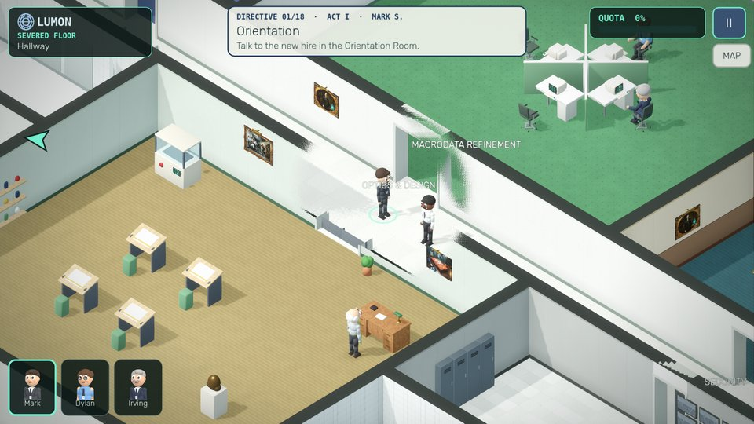
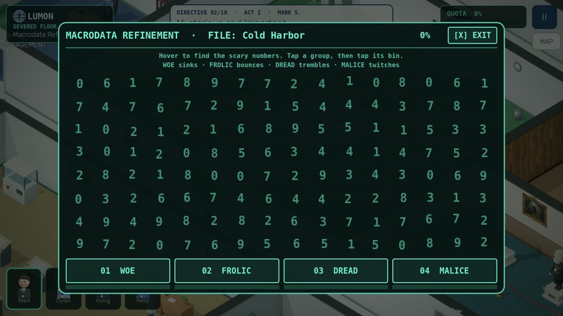
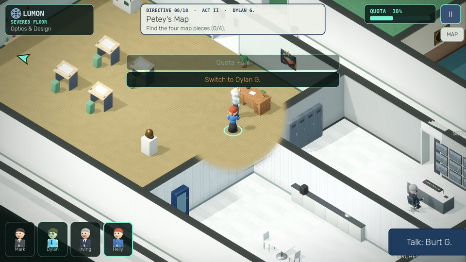
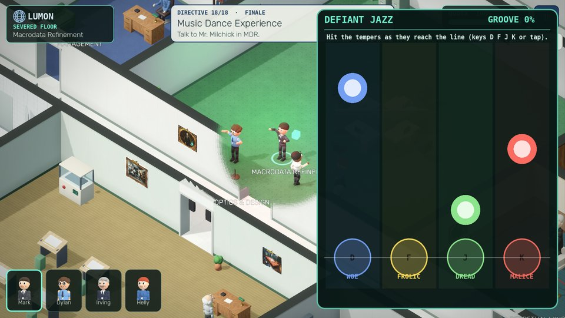

# Severance: Lumon Office

**An isometric adventure on the severed floor. Refine scary numbers, smuggle contraband, feed the baby goats,
pull the Overtime Contingency — and dance to Defiant Jazz. Play in the browser, on Android or on Windows.**

**[▶ Play online](https://severance.lol/)** · [Google Play](https://play.google.com/store/apps/details?id=com.maxsoft.Severance) · [Android APK](https://github.com/msveshnikov/severance/releases/latest/download/Severance.apk) · [Windows exe](https://github.com/msveshnikov/severance/releases/latest/download/Severance.exe)

 
 

## The game

You play four innies of Macrodata Refinement — **Mark, Helly, Dylan and Irving** — and switch between them at any
moment. Eighteen directives in three acts and a finale take you through the whole floor and below it:

- **Macrodata Refinement**: find the scary numbers by how they move — Woe sinks, Frolic bounces, Dread trembles,
  Malice twitches — and sort them into the right bins.
- The Statement of Compunction, a wellness session with Ms. Casey, the O&D fabrication printer, a keypad, baby goats.
- **Stealth**: carry contraband past Milchick's and Graner's vision cones; lift a keycard while Graner naps.
- **Overtime Contingency**: two switches, far apart, held at the same moment — park one innie on a switch, swap,
  and send another to the second.
- The **Music Dance Experience**: a four-lane rhythm game to a swing loop, with the whole department dancing.

Tap or click to walk, tap people and objects to interact; on PC also WASD, E, Tab / 1–4, mouse wheel to zoom.
English and Russian.

## How it's made

Made with Claude Code and the game-pipeline skill: no asset was made by hand.
- **Blender, driven by Python** (`blender/scripts/`): 71 props, 12 rigged characters with 19 procedural animations,
  and both floors built from the plans in `office_plan.py`.
- **Godot 4.7** assembles each level at runtime from glTF + JSON, walks characters on an A* grid and melts walls
  between the camera and the player with a cutaway shader (`shaders/cutaway.gdshader`).
- Music and sounds are synthesized by `tools/make_audio.py`; textures are painted by `tools/make_textures.py`.

Building, testing and deploying: [AGENTS.md](AGENTS.md). Design decisions: [decisions.md](decisions.md).

*A non-commercial fan game inspired by the series Severance; not affiliated with Apple TV+ or the show's creators.*
